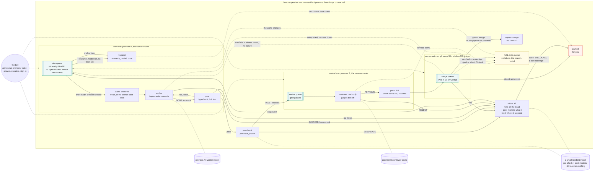

# bead-loop

Work [beads](https://github.com/steveyegge/beads) with any models, local or paid, in any
repo. One resident supervisor runs lanes side by side, one per provider — a **dev lane**
where the implementor model works a bead in its own worktree and a gate proves it, and a
**review lane** where reviewer seats judge the diff and push the PR — over three queues:
**dev**, **review**, **merge** (CI on GitHub), with a **merge watcher** on the third. A
bead whose files are not yet known can take an optional **research** round first, on a
model that can afford to read and write a brief; a gate that passes goes through a
**pre-check** before it spends a review round. Green merges, the bead closes. A bead sent
back from review or from CI returns to the dev queue with a note and one more
**failure**; enough failures move it to a stronger stage, the last one a metered provider
(Claude Code, an API). No model runs the loop; models do the jobs that need judgement,
and neither waits for the other — or for a clock.



| Role | What | Configured by |
| --- | --- | --- |
| Supervisor | `bead-supervisor`, one packed BAML binary (`baml_src/`), resident | the global config and each repo's `.bead-loop.toml`; kept up by `bead-supervisor.timer` |
| Implementor | the BAML `Work` agent on the stage's model, with the loop's own tools (read, write, edit, search, run) — or one Claude Code turn for `claude/*` | `[[stages]].worker`, one provider per stage; `research_model` for the optional research round |
| Reviewer | the BAML `Review` agent, read-only, returning a typed verdict and work order | `[[stages]].reviewer`; `precheck_model` for the pre-check |
| Pre-checker | the BAML `Precheck` function, one call on the diff | `precheck_model` — a small resident model beside the workers; ~20 s a call, evicts nothing |
| Second opinion | the `Research` agent again, on a researcher's `BLOCKED:` | `brief_model` |

Each model is a `[providers.NAME]` in the config, naming how it is reached, how many
sessions it runs at once and what it costs; `NAME/model` names it everywhere else — a
stage's `worker`, a seat, `research_model`, `brief_model`. [docs/config.md](docs/config.md)
lists the provider keys; [Your setup](#your-setup) below shows four of them end to end.

## How it runs

`bead-supervisor run` is one process that stays up. Each lane takes the top of its
queue, runs the round, moves the bead on, and takes the next; the merge watcher asks
GitHub about every PR in flight every 30 seconds. A loop with nothing to do blocks on
**the bell** — a one-second look at the queue directories, the repos' `.beads/` and a
`wake` file — and every producer rings it, so the GPU takes the next bead the second the
last one leaves it. Nothing waits on a clock while there is work, and nothing polls while
there is none.

Targets are configured in `.bead-loop.toml` under `[targets.NAME]` tables, with keys like
`path`, `base`, `base_remote`, `push_remote`, `pr_repo`, `setup`, `gate`, `merge`,
`merge_label`, `adopt`, `max_inflight`, `open_pr` and `pr_style`. A bead with a
`work:NAME` label picks the target of that name; the default target is the beads repo
itself. [docs/design-targets.md](docs/design-targets.md) explains the target concept
and how the PR is opened; [docs/config.md](docs/config.md)'s Targets section lists the
target keys and their defaults.

Targets are configured in `.bead-loop.toml` under `[targets.NAME]` tables, with keys like
`path`, `base`, `base_remote`, `push_remote`, `pr_repo`, `setup`, `gate`, `merge`,
`merge_label`, `adopt`, `max_inflight`, `open_pr` and `pr_style`. A bead with a
`work:NAME` label picks the target of that name; the default target is the beads repo
self. [docs/design-targets.md](docs/design-targets.md) explains the target concept
and how the PR is opened; [docs/config.md](docs/config.md)'s Targets section lists the
target keys and their defaults.

A bead's target can be configured with `merge = "external"` to let someone else merge
the PR, and `open_pr = "ask"` to let the operator open the PR. [docs/design-targets.md](docs/design-targets.md) explains
the target concept and how the PR is opened; [docs/config.md](docs/config.md)'s Targets section lists the
target keys and their defaults.

Lanes derive from the providers named by the stages, seats, `research_model` and
`brief_model`: one lane per provider, as wide as its `parallel`, in the order the
providers first appear — a round on one provider never holds another's queue, and a bead
escalated to a wider one runs at once. `[[lanes]]` in the global config groups providers
under a name of your choosing (`gpu`, `cpu`, `claude` on this box, see
[docs/examples/homelab.md](docs/examples/homelab.md)) when one lane per provider is not
the shape you want. Infrastructure failing — a server down, setup broken, CI silent — is
never the bead's failure: the bead is **held** with the reason until the world changes. A
bead the models cannot land is **parked** for you with a written brief: what happened,
why, and the question to answer.

### The pre-check and the post-mortem

Why a 4B: the pre-check asks three mechanical questions a small model answers as well
as a large one — did `DONE:` quote a command, does the diff touch only the files the
bead named, is anything added that the bead did not ask for — cheap enough to ask on
every gate pass. The numbers said why it is worth asking: 9 of 11 rounds on 21 Sep 2026
died before any reviewer saw them, each still spending the reviewer's five minutes and
its one slot on a diff no reviewer could have approved.

Why inline and not a lane: a lane takes rounds by provider, so the small model as a
lane would queue each pre-check behind whatever that lane was already running. Inline,
the pre-check is one synchronous call inside the dev round, from any lane; it waits
only for a free slot on its provider, never behind another lane's queue.

Why a SEND BACK still counts as a failure: a send-back is a send-back, wherever it
comes from. What the pre-check saves is the reviewer's minutes and its one slot, not
the failure count.

It never blocks or holds: a pre-check that cannot run — the model down, no verdict in
its answer — falls through to the review queue, as if no `precheck_model` were set.

A send-back it catches is a `precheck_sent_back` event in the bead's log, apart from a
reviewer's `rejected`.

## Layout

The units (`bead-supervisor`, `bead-loop-ui`) run their command
through `flox activate -d @HERE@ --` (where `@HERE@` is the directory from which `install.sh`
is executed), so every tool resolves from `.flox/env/manifest.toml` the same way on every
box; `systemctl --user show -p Environment` carries no `PATH=` line. `flox activate` on a
warm env adds under 100ms.

## Install

`./install.sh` packs the binary (`scripts/pack.sh`), puts it in `~/.local/bin`, links
`skills/` into Claude Code and opencode, installs the user units, seeds
`~/.config/bead-loop/config.toml`, and enables
+ starts the loop (`opencode-web.service`, `bead-loop-ui.service`, `bead-supervisor.timer`
— the timer is the keeper, see systemd/bead-supervisor.timer) so it is running when the
script returns and comes back on its own after a crash or a reboot. Re-running it (every
deploy) never interrupts a session in flight: `enable --now` only starts a unit that
isn't already up. At run time it needs `bd`, `git`, `gh` and GNU `timeout`; `flox activate`
in this checkout provides them. Rounds call the model servers themselves; opencode is not in the loop's path. `baml-cli` is downloaded
by `scripts/ensure-baml.sh`.

The loop surviving a reboot with nobody logged in also needs **linger** for this user —
`install.sh` tries `loginctl enable-linger` itself and tells you if it couldn't (it needs
root): `sudo loginctl enable-linger $USER`, once.

### On macOS

[docs/setup-macos.md](docs/setup-macos.md) is the guide for someone setting it up for
the first time: one line in Terminal runs `scripts/setup-macos.sh`, which installs Flox
if needed, checks this repo out to `~/bead-loop`, runs `install.sh` and signs in to
GitHub. `scripts/configure-models.sh` is the opt-in that points the loop at a shared
model server (llm-box), and optionally at Ollama on the Mac.

### On macOS, from the flox package

The package is the supervisor, the page, `bead-loop-install` (this `install.sh`), and the
agents, skills and launchd templates beside them. The tools a round runs (`bd`, `git`,
`gh`, `jq`, `curl`, `node`, GNU `timeout`, bash 5) come with it:

```bash
flox install imkarrer/bead-loop                    # into the environment you live in
bead-loop-install                                   # links, config, and the launchd agents
```

`bead-loop-install` builds nothing. It links `agents/` and `skills/` into opencode
through that environment, whose path an upgrade keeps, seeds the config, and starts two
launchd agents in `~/Library/LaunchAgents`: `dev.bead-loop.supervisor` (the loop) and
`dev.bead-loop.ui` (the page). launchd keeps both up (`KeepAlive`) and starts them at
login. They log to `~/Library/Logs/bead-loop/`, and the page shows the loop's file there
where Linux shows the journal. A re-run leaves a loaded, unchanged agent alone. From a
checkout, `./install.sh` does the same on macOS, with the agents running the checkout
through its flox env, as the units do on Linux. To stop the loop:
`launchctl bootout gui/$(id -u)/dev.bead-loop.supervisor`.

On macOS the agent's `KeepAlive` is the keeper, not a timer, and the page's Start and
Stop act on the systemd units only. A provider on the LAN needs one
**Local Network** allow the first time `bead-supervisor` reaches it (System Settings →
Privacy & Security → Local Network). Until then its rounds are held, not failed.

Per repo: label the beads the model may work (`bd label add <id> delegate:local`; each
needs a DESCRIPTION naming the files and an ACCEPTANCE CRITERIA the worker can run — `bd
dep add B A` is the ordering; the `delegate` skill, linked into `~/.claude/skills` for
you, says what a bead needs before it goes), copy `bead-loop.example.toml` to `<repo>/.bead-loop.toml`
(the base branch, `setup`, `gate`, `merge`), add the repo to `repos` in the global
config, and have CI report a status on the repo's PRs with `gh` logged in. Every key:
[docs/config.md](docs/config.md).

The skills for writing those beads (`breakdown`, `delegate`, `beads`, `bead-workflow`) are
also an [agent-stacks](https://agent-stacks.org) plugin, for a repo whose agents run from a
stack: `flake.nix` builds `agent-plugin-bead-loop` for a stack to list in its `plugins`,
and `nix run github:imkarrer/bead-loop#planner` is Claude Code with them and nothing else.

## Your setup

- [docs/examples/homelab.md](docs/examples/homelab.md) — the live setup: a GPU box and a
  big CPU box as two local providers, a lane per server, Claude Code as the
  last stage, and the three shapes of repo config it is used with.
- [docs/examples/laptop-ollama.md](docs/examples/laptop-ollama.md) — one local provider
  on Ollama and a metered reviewer (written for the Rust loop; see its status note).
- [docs/examples/api-only.md](docs/examples/api-only.md) — no local model, one metered
  provider wide enough to run several beads at once.
- [docs/examples/quorum.md](docs/examples/quorum.md) — three reviewer seats from three
  families, voting.

## Run

```bash
bead-supervisor run --config_file ~/.config/bead-loop/config.toml      # what the unit runs
bead-supervisor lint --config_file REPO/.bead-loop.toml --ids ID --run true
bead-supervisor tell --config_file REPO/.bead-loop.toml --id ID --what answer --text "..."
```

The page, **<http://127.0.0.1:4097>**, shows every repo's beads where they are, every held
bead with its reason and every parked one with its question and the Answer, Reopen and
Escalate levers ([docs/operating.md](docs/operating.md)).

## Docs

- [docs/config.md](docs/config.md) — every key; lanes per server; the stages; the merge modes
- [docs/state-machine.md](docs/state-machine.md) — one bead start to finish; every outcome, state and exit
- [docs/operating.md](docs/operating.md) — the page, the terminal, stop/restart/recover, the state on disk
- [docs/pipeline.md](docs/pipeline.md) — dogfood: the checks, Buildkite, the automerge label, the deploy
- [docs/design.md](docs/design.md) — why this shape (the Rust loop's harnesses; [docs/design-baml-native.md](docs/design-baml-native.md) is the rebuild)

## License

[Functional Source License, Version 1.1, MIT Future License](LICENSE.md) (FSL-1.1-MIT).
Use it, read it, change it, run it inside your own team — everything except offering it as a
competing product or service. Each version becomes plain MIT two years after its release.
Contributions are accepted under the same license.
