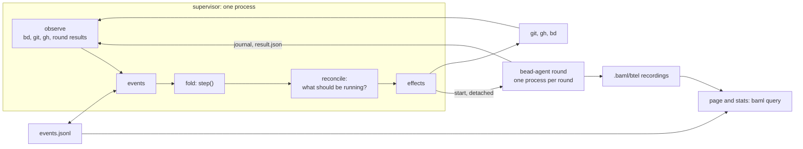

# Design: bead-loop, rebuilt on BAML

Status: proposed, 2026-11-07. The owner's decision: a complete rebuild, BAML first, with
no compatibility kept. Nothing is built. The load-bearing claims were run on this box on
`baml-language` 0.25.2, in a throwaway project; [the checks](#the-checks) say what held and
what did not. The sketches below are illustrative and were not themselves compiled.

[design-baml.md](design-baml.md) covers what BAML is now and what it records.

## Principles first

Each principle below is BAML's own. The right column is what it forces on the loop.

| BAML | so the loop |
| --- | --- |
| Types persist at runtime | has no text protocol. `DONE:`, `APPROVE:` and `BLOCKED:` go; every boundary is a class |
| `match` must be exhaustive | writes "every state has an exit" as a compile error, not a doc |
| Errors are typed and checked | writes "infrastructure is never a failure" as a compile error too |
| An LLM call is a function | has phases that are typed functions, tested like functions |
| Green threads | has lanes as tasks and provider slots as `Limit`s. No lock files |
| The runtime records everything | has no stamps and no scoreboard code. Stats are SQL |
| Tests and evals are in the language | has no stub binaries. A fake `ai.Client` and fake world run in `baml test` |
| Interfaces | has one code path for production, bench and test, behind `World` |
| The filesystem is the module tree | is laid out by concern, `ns_*` per layer |
| A program packs to one binary | deploys one file |

The two compile errors are the heart of this. `NonExhaustiveMatch`, `NonExhaustiveCatch`
and `ThrowsContractViolation` are real compiler diagnostics ([type_error.rs]). Today those
two laws are prose in [state-machine.md](state-machine.md), upheld by review and 140-odd
integration cases. Here, adding a state without its exits does not build.

## The core

Pure code first: no model, no IO, nothing that can time out.

This is built, in `baml_src/ns_machine/`, with the outcome table of `state-machine.md` as 68
tests. Nine deliberate faults were each caught by a test.

```baml
type Place = Ready | Researching | Working | InReview | Reviewing | Publishable | Merging | Parked | Closed;

// What a model did. The only events that can charge a failure.
type ModelOutcome = WorkerBlocked | NoCommit | RoundTimedOut | WorkerCrashed | GateFailedTwice
                  | DiffProblems | PrecheckSentBack | Rejected | ReviewerCrashed | ChecksRed;

function step(b: Bead, e: Event, p: Policy) -> Step throws never { ... }
function charge(b: Bead, o: ModelOutcome) -> Step throws never { ... }
```

`charge` takes only a `ModelOutcome`, so passing it an `Infra` event is `E0001`: infrastructure
cannot reach the failure count. A hold is a field on `Bead`, not a `Place`, because the spec
has it orthogonal: a held bead stays in its queue.

Three things fall out of this.

**"One place" stops being an invariant.** A bead's state is one `Place`, so it cannot be in
two queues. Today that takes filters over `review/`, `inflight/` and the lanes.

**State is an event log.** `beads/ID/events.jsonl` is append-only, and a bead's `Place` is a
fold over it. This replaces the failure counts, `rounds.jsonl`, `review/ID`, `inflight/ID`,
its `.red` and `.conflict` markers, `parked/`, `held/` and `lane.*`. There is one thing to
read, and history comes free. Every persisted variant carries a literal field, `kind:
"rejected"`: JSON drops the class name, and with `kind` a `decode<Event>` gets the right one
back.

**Tests need no stubs.** `step` is a pure function, so every row of the outcome table in
`state-machine.md` is a `test` block on literal data.

## Second: the supervisor

With that core, little is left. The supervisor is three small pieces.



**1. A reconciler, not a driver.** Every heartbeat: observe the world, turn differences into
events, fold, then compare what is running with what should be. This is a controller loop.
Invariant 2, "every wait times out and re-reads the world", stops being a rule for each wait
and becomes the only way anything happens. The merge watcher, adoption, hold expiry and the
bell all become observations. An effect must be safe to repeat, because a crash can land
between doing it and recording it: a PR is found or created, never just created.

**2. One process per round.** The supervisor starts `bead-agent round` detached, and it
writes its journal and a `result.json`. `baml.sys.subprocess` has a `detached` option, and
dropping the handle does not kill the child ([sys.baml]). **The supervisor's unit must set
`KillMode=process`:** `detached` is a new session, not a new cgroup, so a default `systemctl
stop` kills the rounds with it. Green threads would be the BAML-first answer, but processes
win here for four reasons:

- a pre-1.0 runtime panic costs one round, not every lane;
- rounds outlive a restart, so the whole rejoin protocol goes;
- aborting is `kill`;
- a whole process can be sandboxed, which per-tool rules cannot do for `bash`.

Green threads still do the work inside each process: lanes in the supervisor, fan-out in a
round.

**3. Crash-only.** I found no signal handling in the stdlib, and that points the right way.
There is no clean stop. Start is the only path: fold the logs, look for results, and check
pids. A round with no process and no result gets a `RoundLost` event, charged to nobody.
Invariant 6, "a stop cuts short", goes, because a stop is a restart.

Of the 18 hazards in `state-machine.md`, this removes the ones about stuck bookkeeping
(7, 11, 12, 13, 14, 16). The ones about the outside world remain as observations (2–6, 8–10,
15): a PR the pipeline never merges is still a hold after 30 minutes. They just become cases
in `reconcile`.

## The agents

Everything from here is a function a round calls. `Agent` is enough for the read-only
phases. `Work` is not, and this is the biggest piece of the build.

| phase | returns | loop |
| --- | --- | --- |
| `Research` | `Brief { files, shape, check, pitfalls }` or `Blocked` | `ai.Agent` |
| `Work`, `FixGate` | `Report { commit, evidence }` or `Blocked` | **our runner** |
| `Precheck` | `Check { pass, reason }` | `ai.Agent` |
| `Review` | `Verdict { decision, findings[], for_the_worker[] }` | `ai.Agent` |
| `PostMortem` | `Lesson` | one call |
| `ParkBrief` | `ParkBrief { happened, why, question }` | `ai.Agent` |

**We now own the harness.** `Agent` has `max_steps`, `schema_attempts`, `client`,
`tool_errors` and `on_event`. It stops after three identical tool failures ([runner.baml]),
but it has no compaction, and `run` always starts a fresh `Journal`, so it cannot resume.
`Work` needs its own `ai.Runner`:

- **Compaction**, at 64k context and about 38 steps a session.
- **A checkpoint per turn**, so a lost round can be resumed instead of redone. This is a
  later gain, since `RoundLost` already makes it safe to skip at first.
- **The stall watchdog**, now a counter in the loop, not a transcript parser.

**What the first real runs taught the harness** (`baml_src/ns_tools`, `ns_agents`, on the
devbox 30B). On `bl-gld`, the first version hung: after a read of 400 of a file's 843 lines,
the model emitted the same `read_file` call 64 times in one reply and ran to the timeout. An
"offset=401" hint did not help. Three settings fixed it: whole-file reads up to 2,000 lines,
`parallel_tool_calls: false`, and `max_tokens`. It then landed in 15 steps against opencode's
16, with a `src/merge.rs` byte-identical to the merged fix, and 126 tests, `fmt` and `clippy`
passing on an independent run. Three lessons stand:

- **The model's report is a claim, not a result.** It said every criterion was met when the
  gate had timed out. The supervisor runs the gate, and `Report` never moves a bead alone.
- **The sandbox must also cut the network.** The model tried `git clone` from GitHub; only
  the read-only filesystem stopped it. `--unshare-net` also cuts the model server, so this
  needs a local forward. On a bench case, an open network can fetch the answer.
- **That bead spelled out its edit**, and context peaked at 18k tokens, so it tested tool use
  and not reasoning, and never touched compaction.

**A harder bead found the next gap.** `bl-b1a.1` ran out of its 50 minutes after 5 steps. Its
one edit was right, but the model sent `\"id\"` for the file's `"id"`. That is a common
local-model habit, and opencode recovers from it. Ours refused, so the model re-read an 831-line
file, its context reached about 35k tokens, and each step took about 10 minutes. `edit_file` now
undoes escaped quotes and newlines when that makes a unique match, and shows the real lines on
a near miss; replayed, the model's own edit applies and matches the merged change. Two things
are still missing: compaction, and keeping whole-file reads from piling up.

**The first end-to-end run parked a bead that had already landed.** A throwaway `mul`
bead: the worker committed, the gate passed, then the reviewer searched 38 times, never
returned a verdict, and ran out of its 40 steps. That was charged as `ReviewerCrashed`, so
the worker was sent back with "reviewer exited: out of steps", found the edit already done,
made no new commit, and `NoCommit` deleted the branch. Three fixes, none of them a model
call: a reviewer with no verdict is Infra (held in review, retried), `charge` keeps a
branch that already passed the gate, and the reviewer has `read_file` only, with 12 steps,
because the diff is in the prompt. The worker's report is written to disk for the next
review; the first e2e passed an empty one. Compaction rewrites the journal before each worker call: the last two tool
results stay, older ones become a length stub, and a read whose text was cut can
be read again. `Agent.run` still keeps the whole journal, so the worker does not
use it.

**Long stalls are the box, not the harness.** Single calls took 5 to 7 minutes on `bl-gld` and
`bl-b1a.1`. During one, disk and swap were silent, the CPU was about 90% idle, and the GPU sat
near 100% with 16.0 of 16.4 GB of VRAM used. Opencode's logs show the same: on busy days 2–3%
of steps took over 2 minutes, the longest 11. Two rules follow. A request that times out keeps
running on the server and blocks the next, so client timeouts stay long. And a model-server
timeout is `Infra`, never a failure.

**The tools are small, except one.** Across 7,501 worker tool calls on this repo, 48% were
read, 32% bash and 12% write or edit. Functions over `baml.fs` and `baml.sys` cover those.
Edit is the exception: how it copes with a 30B's near-misses is much of a harness's quality.
Start with exact match, a useful error, and whole-file write as the fallback.

**Each phase gets only its tools.** A reviewer has no write tool, which replaces the
permission tables. `Work` runs under `bwrap`: its worktree writable, the rest read-only.

**Fake clients come free.** BAML's own tests script a client that implements `ai.Client`
([agent_error_events.baml]). The same pattern tests a whole round offline.

## Models

```baml
client Devbox = openai.GenericClient.new(model = "coder", base_url = env.DEVBOX_URL);
client Acbox  = openai.GenericClient.new(model = "reviewer", base_url = env.ACBOX_URL);
```

A client is a value, so the stage table is typed data and routing is a function. Splitting
`Work` into `Plan` then `Edit` on different models, fanning `Review` out per criterion, or
`pick_worker(features)` are ordinary code. Each remains a hypothesis for the bench.
`Retry`, `Fallback` and `RoundRobin` handle a failing provider. Stages handle a failing bead,
and live in `step`. `.bead-loop.toml` stays, decoded to a class.

**The last stage is `ClaudeCodeClient`**: see [the decision](#decisions-for-the-owner).

## Prompts

Prompts live in the `.baml` source, as constants in `prompts.baml`. Each recording keeps a
snapshot of the project's sources (`source_cas`, [schema.rs]), so every span is already tied
to the exact prompt that ran. The current `agents/*.md` are the first draft, nothing more.

**The optimizer is GEPA, and it sits outside BAML.** `baml-cli optimize` exists only in v0,
and is commented out of the new CLI ([v1 commands.rs]). GEPA itself is MIT and takes any text
and any evaluator ([GEPA]). It rewrites a constant, `bead-agent eval` scores it on frozen
cases, and it reflects on send-back notes and gate output.

At median session times and on one slot, 150 evaluations cost about 5 h for `Review`, 10 h
for `Research` and 17 h for `Work`, before the gate and any repeats. There are no frozen
cases yet, and about 36 candidates. Hold a third back, and judge only on those.

## Measurement

| today | rebuilt |
| --- | --- |
| `stamps.jsonl`, `build.rs`, `prompt_hash` | the recording's source snapshot, plus `BAML_CONTEXT` for bead and round |
| `stats.rs`, 1,500 lines | SQL over recordings and `events.jsonl` |
| `reason_of` prefix matching | `RoundEnd` and `Verdict.findings`, typed |
| local sessions as opencode events | every step, with raw requests and replies |
| Claude sessions with no trace | still one turn each, by decision |
| `total_cost_usd` from the log | still a log line: see below |

**Metered cost needs its own capture.** `ClaudeCodeClient` reports tokens in `usage`, but the
cost appears only in a `log.info` line (`cost_usd=0.019121`), not in `usage` or any span. The
headline metric is metered USD per landed bead, so a round runs with `BAML_LOG=info`, keeps
its stderr, and writes the figure into its `result.json`. It is a fragile parse of a log
line; a `cost` field upstream would be better.

**Tool calls are in the journal, not the spans.** `spans` has LLM functions and HTTP requests.
A round writes `on_event` to its log, which is where tool calls and arguments live.

**Recordings land by `BAML_HOME`.** A packed binary writes to `$BAML_HOME/btel`, and `baml
query --local` reads `<project>/.baml/btel`. A round sets `BAML_HOME` to that repo's
`.baml` and `BAML_CONTEXT` to the bead, the kind and the round log, and the sandbox
bind is only `.baml/btel`. `context_distinct_id` is the bead id. `--from` does not
help in 0.25.2, and open PR #5539 will change this layout.
| a bench that cannot run | `OfflineWorld`, below |

**The bench is not a separate system.** `World` is an interface over `bd`, `git` and `gh`.
`LiveWorld` is production. `OfflineWorld` is a fresh clone with no `gh` and no `bd`, and it
runs the same round code, so the thing measured is the thing shipped. Bench rounds join the
same supervisor as low-priority work, and `Limit` already keeps them out of production's way.
`FakeWorld` is the test double. Today, that would be three systems.

## What goes, what stays

**Gone on this branch:** `src/`, `test/run.sh` and `test/bin`. CI packs the BAML binary
and tests `baml_src/`. Still here, and still in front of a real switch: opencode, aider,
`agents/`, `bin/bead-loop-ui` (it still shells out to the old `status` / `stats` /
`doctor` commands), most of `systemd/` beyond the supervisor unit.

**Stays:** `bd` and the beads, `git`, `gh`, the Buildkite pipeline, `skills/`, `CONTEXT.md`'s
vocabulary, `ui/index.html` served from `baml.http.Server`, and **`state-machine.md` as the
spec**. Its outcome table and hazard list are months of incidents compressed; port those, not
the code.

Beads carry over untouched, and rounds in flight are simply run again.

## Layout

```
baml.toml
baml_src/
  ns_machine/   Bead, Place, Event, step, stage_for
  ns_supervisor/ reconcile, effects, heartbeat
  ns_world/     World, LiveWorld, OfflineWorld, FakeWorld
  ns_agents/    one file per phase, prompts.baml
  ns_runner/    the Work loop, compaction
  ns_tools/     read, grep, edit, shell
  ns_models/    clients, routes
  ns_page/      server, views
  ns_evals/     cases, testsets
```

## The checks

Run 2026-11-07 on `baml-language` 0.25.2, the static musl build, in a throwaway project.

| check | result |
| --- | --- |
| a `Place` arm missing, or a new `Place` with no arm | **held.** `E0062`, build fails |
| `Infra` thrown from `throws never`, directly or through a call | **held.** `E0096`, build fails |
| `step` and fold as pure tests | **held.** 4 tests, no stubs, no model |
| tool calls with `GenericClient` on the devbox 30B | **held.** Two tool calls and a typed `Verdict` citing the planted bug's line, in 7 s |
| raw traffic by SQL | **held.** Full request, raw reply, status, timing; other headers hashed |
| `BAML_CONTEXT` as the join key | **held.** Bead, round and log stem queryable beside usage |
| `ClaudeCodeClient` | **held, with a gap.** Typed `Verdict` in 8 s on the subscription; cost only in a log line |
| `baml pack` | **held.** 39 MB static binary, subcommand per function, CLI from the signatures |
| child survives `kill -9` of its parent | **held** |
| child survives `systemctl stop` | **failed by default**, held with `KillMode=process` |
| no egress | **held.** Traced with `strace`: one connection, to `127.0.0.1:8100` |
| `bwrap` | **held.** Writes outside the worktree denied; the model still reachable |
| recording volume | **fine.** 6.3 MB for a 38-step session reaching about 250 KB of context |
| `BAML_TELEMETRY_HTTP_BODIES=off` | **does not exist** in 0.25.2. No switch for bodies |
| `BAML_TELEMETRY=off` | **ignored by packed binaries**; works under `baml-cli run` |
| a resident process | **held for 44 minutes.** 12,000 ticks, about 8 days of a 60-second heartbeat. Memory flat, 73 MB then 75 MB; 9.7 MB of recordings. Not a real multi-day run, and it held no sockets or model calls |

The recording results rest on a fake model server for volume and on one small real bug for
tool calling. Neither shows how a 30B behaves across 38 real steps, which step 5 will.

**Bodies always record, so treat recordings as sensitive.** They hold prompts and code, with no
way to turn that off in a packed binary. At 6.3 MB a session and 833 GB free this is not a
space problem yet, but it needs a retention rule.

## Build order

A walking skeleton, each step runnable.

1. **The checks.** Done.
2. **`ns_domain` and `ns_machine`.** Types and `step`, with the outcome table as tests. No
   model, no IO.
3. **The supervisor on `FakeWorld`.** A bead goes from ready to closed with scripted clients.
4. **Read-only agents** against the real local models.
5. **`Work`, its tools and the sandbox.** First real bead landed on a throwaway repo.
6. **`LiveWorld` on a small repo.** Then this one, and the Rust loop goes off.
   The watcher now speaks this repo's merge mode: a pipeline PR green for 30
   minutes is held, a check the base does not require is not charged, a killed
   required check is re-run once, and a skipped build is not a result.
   `bead-loop run --config_file .bead-loop.toml` reads that file and the global
   stages. A `claude/` stage is one Claude Code turn. A round starts under
   `bwrap` when it is on `PATH`, worktree and git dir writable, the rest not.
7. **The page, `OfflineWorld`, research, park brief, compaction.** Walking skeletons
   built on this branch: `bead-loop page` serves `/` and `/api/status` from a fold of
   the log; `bead-loop bench` runs a case on `OfflineWorld` (no bd, no gh); research
   runs before work when the policy names a researcher; a park writes `park.md`;
   `compact_outputs` stubs the oldest tool results.
   The worker compacts its own journal between calls. CI on this branch is the BAML
   tests and `baml pack`; `src/` is gone. The unit runs
   `bead-supervisor run --config_file ~/.config/bead-loop/config.toml` with
   `KillMode=process`, and that file's `repos` list is every checkout. Still in front
   of a real switch: one real bead closed on this binary, the operating page, lanes
   that overlap the GPU and the Z840 (the loader still forces `lanes: 1`), and the
   pre-check.
8. **The evals, then GEPA.**

Work on a long-lived branch. A merge to `main` deploys to the box: the release step
publishes the packed binary as `bead-supervisor`, and the timer installs it and restarts
the unit. That merge is the switch. This branch is not `main`.

## The main risk

There is no fallback in the rebuilt loop. The runtime is pre-1.0, moved three releases on 6
November, and removed `trace.rich()` in a point release. A blocking runtime bug stops the loop
until it is fixed upstream or worked around. Pinning a packed binary contains upgrades, not
bugs. The process-per-round split limits the blast radius; it does not remove the dependency.

## Decisions for the owner

**The last stage: decided, `ClaudeCodeClient`.** The owner, 2026-11-07: local models exist
   to save money, and the traces that matter are the local models'. Claude Code keeps the
   subscription and its own tools, and BAML sees it as one turn. Accepted: the last stage
   stays opaque and runs on a different harness.

Defaulted unless you say otherwise: `bd` stays, the rebuild lives in this repo, and
`.bead-loop.toml` stays as TOML.

## Sources

BAML sources are on `canary`, read 2026-11-07.

[type_error.rs]: https://github.com/BoundaryML/baml/blob/canary/baml_language/crates/baml_compiler_diagnostics/src/errors/type_error.rs
[sys.baml]: https://github.com/BoundaryML/baml/blob/canary/baml_language/crates/baml_builtins2/baml_std/baml/ns_sys/sys.baml
[runner.baml]: https://github.com/BoundaryML/baml/blob/canary/baml_language/crates/baml_builtins2/baml_std/ai/runner.baml
[agent_error_events.baml]: https://github.com/BoundaryML/baml/blob/canary/baml_language/crates/baml_tests/baml_src/ns_llm_agent_error_events/agent_error_events.baml
[schema.rs]: https://github.com/BoundaryML/baml/blob/canary/baml_language/crates/baml_query_btel/src/schema.rs
[v1 commands.rs]: https://github.com/BoundaryML/baml/blob/canary/baml_language/crates/baml_cli/src/commands.rs
[GEPA]: https://github.com/gepa-ai/gepa
