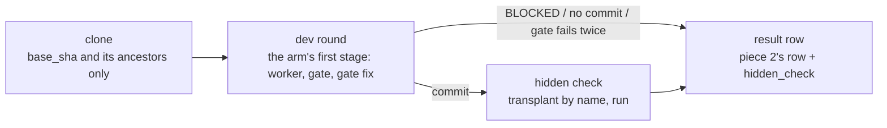

# Design: the replay bench

Status: proposed; grilled 2026-10-28 (decisions 30–35 below). Written from decisions 5, 6 and 26–29 of
[design-measurement.md](design-measurement.md) and ADR 0003. Nothing here is built.

## What it is for

Production rows (piece 2) say what happened to the beads that came; they cannot say
whether config B would have done better on *the same* beads. The bench replays closed
beads under two **arms** — two configs, or two commits of bead-loop — and compares them
on the same **cases**, offline, with repeats. Terms are in [CONTEXT.md](../CONTEXT.md).

## A case

A case is a closed bead, frozen once into `cases/ID/`:

| file | what |
| --- | --- |
| `case.json` | id, repo, `base_sha` (the merge commit's first parent), `merge_sha`, the bead's title, description and acceptance criteria as the first worker round saw them, the claim features (piece 2), and the set it belongs to |
| `hidden/` | the tests the merge added, cut by name (below); empty for a gate-only case |

The first case set (decision 27): the landed beads whose merge added a test — on
bead-loop on 2026-10-28, about 36 of the 84 the loop landed — plus the parked beads,
the hard cases. Landed beads whose merge added no test form a **gate-only** set, scored
on the gate alone and never pooled into a pass rate with the first.

## A run

```bash
bead-supervisor bench --arm A.toml --arm B.toml [--cases DIR] [--repeat 3]
```

For each case, arm and repeat:



- **Isolation (decision 5).** No `bd`, no `gh`, no push. The worktree is a fresh repo
  that fetched only `base_sha` (`git init && git fetch SRC BASE_SHA`), so the merge
  and everything after it are not in its object store: the answer cannot be read from
  history. It keeps `.beads/` as the base had it (decision 34).
- **Slots (decision 5).** Provider slots move from an in-process counter
  (`harness.rs` `provider_slot`) to lock files under `$STATE_DIR`, shared by the
  supervisor and a bench process. The bench only *tries* for a slot and waits when it
  gets none; it never queues ahead of production.
- **The reviewer is off by default** (decision 28): the hidden check judges the result.
  On, it is an arm, which measures the reviewer itself — hidden-check fails it catches,
  passes it rejects.
- **The frontier baseline is an arm** whose config has only the last stage (ADR 0003).

## The hidden check: transplant by name

Rust unit tests live in the file the worker edits, and a bead's acceptance often names a
test the worker writes itself. A hunk-level patch would conflict on both. So the check
is placed by name (decision 26):

- Each `#[test] fn NAME` the merge added in `src/` is cut out whole. In the worker's
  tree it replaces the worker's `fn NAME` in that file's `mod tests` if there is one,
  else it is appended to that module.
- Each `case_NAME` the merge added to `test/run.sh` is copied whole and run by name.
- Then `cargo test NAME...` and `test/run.sh NAME...`.

Outcomes: **pass**; **fail** (a test runs red, or does not compile against the
worker's code); **inconclusive** (a test cannot be placed — no such file, no `mod
tests`), reported apart from both.

## What a run reports

Per arm: the pass rate over cases with an interval; per case, the fraction of repeats
that passed. Beside it, the piece 2 diagnostics for the bench's rounds: send-backs by
reason, rounds, metered USD, model time.

## Decisions (round 4, 2026-10-28)

30. **The comparison is paired**: per case, the difference in the fraction of repeats
    that passed, averaged over cases, with a bootstrap interval over cases. It uses
    every repeat, and it reads as "B passes 0.18 more of a case's repeats, 0.05–0.31".
31. **A transplanted test brings what it leans on**: the helpers in the merge's `mod
    tests` that the transplanted tests call by name, and the merge's `test/bin` whole.
    The stubs advantage neither arm; without them most `case_` tests would be
    inconclusive.
32. **Pre-check and research run as in production**; either off is an arm. They are
    part of the dev round being measured, and a pre-check send-back is an outcome.
33. **A case's text is marked by where it came from**: `text: first_round` from piece
    2's claim line, or `text: current` for beads claimed before it, reported apart
    until the first-round set can stand alone.
34. **The clone keeps `.beads/`** as the base commit had it, as production's worktree
    carries its own.
35. **Cases live in the repo** under `bench/cases/`, written by `bead-supervisor bench
    freeze`: reviewed and versioned, the same for everyone benching one commit, and a
    wrongly frozen case is fixed in a PR.

## Open

The build order of the bench's parts, and whether the slot lock files (decision 5) ship
on their own first, since production gains nothing from them until a bench runs.
