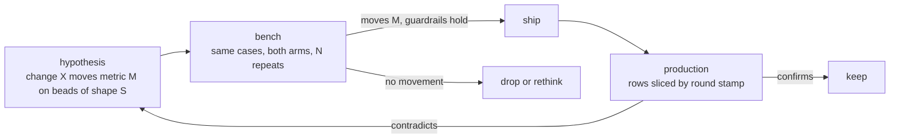

# Design: measuring a change — to the loop, or to a config

Status: proposed; grilled 2026-10-28 (decisions below, ADRs 0001–0003). Nothing here is
built; no beads yet.

## What is wrong now

The loop can say how it did, but not why it did better or worse. The scoreboard
(`src/stats.rs`) sums what the beads and the logs already record — landed, first try,
rounds per landed, send-backs by reason, model time, model cost, avoided cost — over four
windows. That answers "how was the last week". It cannot answer the questions a change
raises:

1. **Did this change to bead-loop help?** A prompt edit in `agents/bead-worker.md`, a new
   pre-check rule, a harness switch. Nothing records which commit of bead-loop, which
   agent prompts or which skills ran a round, so a week's numbers mix every version
   that ran in it.
2. **Is config A better than config B?** A different model on stage 1, `parallel = 2`, a
   cheaper metered stage before Claude. Same problem: the resolved config a round ran
   under is not written down.
3. **Should this bead be delegated at all?** The scoreboard's avoided cost is a
   gross figure. It does not subtract the metered session that *planned* the bead, the
   metered stages a failed bead escalated to, or the owner's time on a parked one, and
   there is no measured baseline for "Claude just did it".

Under all three: **the comparison is never controlled.** Production beads differ
week to week, each runs once, and a local model's sampling is noisy. A config that
"landed more" may have been handed easier beads. And nothing measures what happens
after a merge: a fast landing that is reverted next week counts as a win today.

## What we want

A method that makes any proposed change — to the code, the prompts, the skills, or a
user's config — a **hypothesis with a predicted movement in a named metric**, testable
before it ships and confirmable after.

Non-goals: a general LLM eval framework; leaderboard-style model comparisons outside a
repo's own beads; dashboards beyond what the existing page and `stats` already show.

## The pieces, in priority order

Pieces 1–3 are small, independent of each other in code, and should land first,
because piece 1 loses data every day it is missing. Piece 4 is the real build. Piece 5
completes the cost side once there is a row to attach it to.

### 1. A stamp on every round

Every model session — worker, gate fix, each review seat, pre-check, post-mortem,
brief, research — writes one line to `beads/ID/stamps.jsonl` saying what produced it
(decisions 3, 4 and 9–12; ADR 0001):

| field | source |
| --- | --- |
| `round`, `kind`, `log` | the round number, the session's kind, its log stem (the join to `logs/`) |
| `loop_sha`, `dirty` | the bead-loop commit the running binary was built from (`build.rs`, from git) |
| `prompt_hash` | content hash of the agent file the session's harness was handed |
| `skills_hash` | content hash of the `skills/` tree the session could load |
| `base_sha` | the target commit the worktree was cut from, or the kept branch's head on a resumed round |
| `stage`, `provider`, `model`, `harness` | the stage and seat as resolved, in plain text |
| `config_hash` | hash of the resolved stage (worker, seats, approvals, harness, provider name, model, `parallel`, `cost`) and the target keys that change a round (`gate`, `setup`, `base`); never credentials or URLs |

Deferred: `server` (what the provider reports about itself: quantisation, context),
until a hypothesis needs it.

Today a send-back record carries the round, the model, the stage, when, the whole note
(the reason, the gate output) and its log files' names (`src/park.rs` `record_round`);
every model session, the landing one included, has a log `logs/ID.STAMP.KIND.jsonl`
whose name carries the bead and the start time. Nothing records what produced them.

`rounds.jsonl` holds send-backs only (`park.rs` `record_round`), and it is prompt input:
the worker reads the last three records. The round that lands has no record, so the
stamp needs a place on every round, including that one, and not one that grows the
worker's prompt.

### 2. One row per bead

`bead-supervisor stats --rows` emits JSONL, one row per bead, so the stamp can slice it.
The scoreboard already computes most of this; it sums it away.

Rows cover every bead the loop touched (`stats.rs` `bead_of`'s test), whatever its
outcome, and are not windowed: the reader filters (decision 15).

- **Features at claim time**, captured at the first claim as a `claim` line in
  `stamps.jsonl`, never rebuilt later (decision 14) (the covariates — "the beads got easier" vs "the loop got
  better"): files named; how many exist on base; description length; acceptance is a
  command or prose; harness; starting stage; greenfield (a named file is created) or
  not; `linted`, from the `lint` note (decision 17); the `planned-in` session, when known.
- **Outcome**: landed, parked or open; first try; rounds; send-back reasons in order;
  stage it landed on; metered USD; local tokens; wall time to land; model time by role;
  `reverted` and `named_by` (the guardrail; null until 14 days after the merge,
  decision 16); **human touches** (answers, unparks, escalations, operator notes — from the bead's
  notes, which `stats.rs` already parses; operator commits on the bead's branch are not
  counted yet).

### 3. The metric definitions, fixed once

Written down before any tuning, so no experiment picks its own success criterion.

- **Headline: metered USD per landed bead**, always reported beside **landing rate**
  (so a config cannot win by parking everything hard) and **human touches per landed
  bead** (answers, unparks, escalations, operator notes and commits). Human time is
  counted, not priced: no minutes are measured, and a rate would hide a trade of the
  owner's time for dollars (ADR 0002).
- **Guardrail: defects after merge.** Within 14 days of a bead's merge: a revert of its
  squash commit on the base, or a later bead whose text names it as the cause. A red
  check on the base traced to it is left out until it can be attributed without false
  positives. None of this is measured today.
- **Diagnostics, never targets:** send-backs by reason, empty rounds, pre-check
  catch rate, gate fix rate, time to land.

### 4. The replay bench

The controlled experiment. Production is observational; the bench runs the same beads
under both arms.

- **A case** is a closed bead frozen as: the base commit (the merge commit's first
  parent), the bead's text as the worker saw it, and a **hidden check** — the tests that
  landed with the merge, applied after the run and never visible to the worker. Parked
  and escalated beads are the hard cases.
- **A run** is `bead-supervisor bench --config FILE [--cases DIR] [--repeat N]`: each case
  in a throwaway worktree at its base commit; no push, no PR, no `bd` writes; reviewer on
  or off, so the reviewer can be measured alone. The result is the same row as piece 2,
  plus `hidden_check: pass|fail`.
- **Repeats**, default 3, because local sampling is noisy. Report pass rate with an
  interval, not a point.
- **What it can resolve:** with ~30 cases, a 40%→65% change, not a few points. The
  case set grows as beads close; the bench is honest about its n.
- **Both audiences.** A change to bead-loop is benched across bead-loop's own cases. A
  user benches a config against their own repo's closed beads before they switch.

Open: contamination (the base commit's later history holds the answer; the worktree
must not reach it); beads whose merged diff carries no test (the hidden check is then
the gate alone, which proves less); how a bench run reaches the model servers without
taking a production lane's slots.

### 5. The whole cost

- **Planning cost.** The metered session that wrote a bead, from Claude Code's
  transcript (`~/.claude/projects/*/*.jsonl` carries usage per message) or its
  OpenTelemetry cost metrics, split across the beads created in it. Needs a
  `planned-in:<session>` mark on the bead, set by the `breakdown`/`delegate` skills.
- **Aider's tokens**, which today add nothing to any total.
- **A direct-to-frontier control**: the measured "just do it with frontier" baseline the
  delegation question needs — a bench arm with the last stage only, not a share of
  production beads (decision 6, ADR 0003).

Then, per bead: `net = C_direct − (C_plan_share + C_escalation + rate × T_human)`,
reported by bead shape.

## The candidate changes, as hypotheses

What the measurement is for. Each stays a candidate until the bench says otherwise.

| change | predicted movement | on which beads |
| --- | --- | --- |
| `bead-supervisor lint`: paths exist, criteria are commands, the check is **red on base** | fewer `false claim` send-backs; first try ↑ | all |
| test-first beads: the planner writes the failing test | first try ↑, hidden-check pass ↑ | edits with a testable behaviour |
| best-of-N on an idle lane, the gate as verifier | first try ↑ at constant metered USD | local stages |
| code search tools for the worker (LSP/MCP, ast-grep, repo map) | `no commit` / `BLOCKED` ↓ | beads that must find their files |
| constrained decoding for tool calls and edits | empty and malformed rounds ↓ | local stages |
| harness per model family | first try ↑ | one model, two harnesses |
| lessons injected by path, from post-mortems | repeat send-back reasons ↓ (e.g. formatting) | beads touching a path with lessons |
| few-shot: the nearest landed beads and their diffs | first try ↑ | beads with a near neighbour |
| deterministic diff-scope check before the pre-check model | pre-check time ↓, catch rate equal | all |
| a mutation check (revert src, keep test, expect red) | after-merge defects ↓ | beads that add a test |
| a cheap metered stage before the last | cost per landed ↓ | escalated beads |
| a landing-probability router for the planner | cost per landed ↓, parks ↓ | at planning time |

## Groundwork

Done by the grill: `AGENTS.md`, `docs/agents/`, the `dev` stack in `flake.nix`, and
`CONTEXT.md` with `docs/adr/`. As it stood when this was written:

- **No domain docs.** There is no `AGENTS.md`, `CLAUDE.md`, `CONTEXT.md` or `docs/adr/` at the
  root. The `breakdown` skill tells a planner to read a target's `AGENTS.md` and
  `CONTEXT.md`; bead-loop's own repo has neither. The vocabulary (round, stage, lane,
  seat, hold vs park, send-back, failure) lives only in the README and the design docs,
  and the terms above (stamp, row, case, run, hidden check) need a home. The engineering
  skills (`domain-modeling` via `grill-with-docs`) create `CONTEXT.md` and ADRs lazily as
  terms resolve; `docs/agents/` records where they live.
- **No stack for working on bead-loop.** `flake.nix` builds `agent-plugin-bead-loop` and a
  `planner` stack for *other* repos' planners. There is no stack for a session developing
  this repo: Claude Code with `agent-plugin-mattpocock-skills` (in `agent-pkgs`), the
  bead-loop plugin, and the flox env's Rust toolchain. Today those skills reach a session
  only because the workstation's flox env installs them globally.
- **An `AGENTS.md`** naming the gate (`.bead-loop.toml`'s `gate`), its fixers
  (`cargo fmt`), the integration suite (`test/run.sh`) and the docs map — the same thing
  `breakdown` asks of every target.

## Decisions from the grill (2026-10-28)

1. **Headline:** metered USD per landed bead, beside landing rate and human touches per
   landed bead; human time counted, never priced (ADR 0002).
2. **After-merge window:** 14 days; a defect is a revert of the bead's commit or a later
   bead naming it as the cause (ADR 0002).
3. **The stamp hashes by content.** `loop_sha` and a dirty flag, compiled in by a new
   `build.rs` from git, `unknown` without it (the flake does not build the binary;
   `install.sh`'s `cargo build` does), plus content
   hashes of the agent file the round was handed and the skills tree it could load —
   `install.sh` links both into the working tree, so they can differ from the binary's
   commit (ADR 0001).
4. **The stamp's home:** a new `beads/ID/stamps.jsonl`, one line per round including the
   one that lands, carrying the log stem it joins on; never prompt input (ADR 0001).
5. **Bench isolation:** fully offline — no `bd`, `gh` or push; the worktree cut from a
   clone holding history only up to the case's base. Provider slots, today a counter
   inside one process (`harness.rs` `provider_slot`), move to lock files under
   `$STATE_DIR` so a bench process shares them, and the bench only *tries* for a slot,
   never queueing ahead of production. The rest is piece 4's design pass.
6. **The frontier control is a bench arm** (last stage only, same cases), not ~5% of
   production. Until the bench exists, the last stage's record on escalated beads
   stands in, read as biased toward hard beads (ADR 0003).
7. **The dev stack** is `dev` in `flake.nix` (built).
8. **Which hypothesis first:** `bead-supervisor lint`. Its predicted movement (fewer
   `false claim` send-backs) is already counted by reason, so pieces 1–2 confirm it in
   production without the bench; it is deterministic and cheap; and running a check
   against the base commit is the machinery piece 4's hidden check needs.
9. **A stamp per model session**, not per round: each carries its round number, kind
   and log stem; a round is the lines sharing a number.
10. **`base_sha` in the stamp**: what code the session started from, and what a case needs.
11. **`config_hash`** covers the resolved stage and the round-changing target keys,
    never credentials or URLs; the stage fields are also written in plain text.
12. **`server` is deferred** until a hypothesis needs it.
13. **Human touches, first version:** from the bead's notes only; operator commits on the
    branch are a known gap.

14. **Row features are captured at the first claim**, as a `claim` line in
    `stamps.jsonl`; beads from before it have none.
15. **Rows cover every touched bead**, unwindowed; `stats --rows` emits them all.
16. **Piece 2 computes the guardrail**: `reverted` and `named_by` per row, null until 14
    days after the merge.
17. **`lint` marks the bead with a dated note** (`lint DATE: pass`, or the failures), not a
    label, so routing is unchanged; the claim line's `linted` reads it. The note is a
    person's line, so it reaches the worker's prompt like any other: a few words of
    difference between the arms, accepted.

**Beads:** epic `bl-ayv`, `.1`–`.6`: `build.rs`, `src/stamp.rs`, the session stamp,
the claim line, `stats --rows`, the guardrail.

**Build order:** piece 1 ships first and alone, since it loses data every day it is
missing; piece 3 is the definitions above; piece 2 next; then piece 4's design pass.

## Sequence

1. Groundwork: `AGENTS.md`, `docs/agents/`, the dev stack. (Done.)
2. Grill this doc with `grill-with-docs`; `CONTEXT.md` and any ADRs come out of it. (Under way.)
3. Piece 1 alone; then piece 2, with piece 3's definitions.
4. Piece 4's own design pass, then the build.
5. Piece 5.
6. The hypotheses, one at a time, each benched before it ships.
