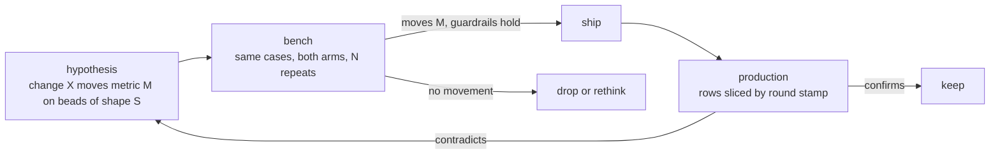

# Design: measuring a change — to the loop, or to a config

Status: proposed, for a grill. Written 2026-10-28. Nothing here is built; no beads yet.

## What is wrong now

The loop can say how it did, but not why it did better or worse. The scoreboard
(`src/stats.rs`) sums what the beads and the logs already record — landed, first try,
rounds per landed, send-backs by reason, model time, model cost, avoided cost — over four
windows. That answers "how was the last week". It cannot answer the questions a change
raises:

1. **Did this change to bead-loop help?** A prompt edit in `agents/bead-worker.md`, a new
   pre-check rule, a harness switch. Nothing records which commit of bead-loop, which
   agent prompts or which skills ran a round, so a week's numbers mix every version
   that ran in it.
2. **Is config A better than config B?** A different model on stage 1, `parallel = 2`, a
   cheaper metered stage before Claude. Same problem: the resolved config a round ran
   under is not written down.
3. **Should this bead be delegated at all?** The scoreboard's avoided cost is a
   gross figure. It does not subtract the metered session that *planned* the bead, the
   metered stages a failed bead escalated to, or the owner's time on a parked one, and
   there is no measured baseline for "Claude just did it".

Under all three: **the comparison is never controlled.** Production beads differ
week to week, each runs once, and a local model's sampling is noisy. A config that
"landed more" may have been handed easier beads. And nothing measures what happens
after a merge: a fast landing that is reverted next week counts as a win today.

## What we want

A method that makes any proposed change — to the code, the prompts, the skills, or a
user's config — a **hypothesis with a predicted movement in a named metric**, testable
before it ships and confirmable after.

Non-goals: a general LLM eval framework; leaderboard-style model comparisons outside a
repo's own beads; dashboards beyond what the existing page and `stats` already show.

## The pieces, in priority order

Pieces 1–3 are small, independent of each other in code, and should land first,
because piece 1 loses data every day it is missing. Piece 4 is the real build. Piece 5
completes the cost side once there is a row to attach it to.

### 1. A stamp on every round

Each round record (`beads/ID/rounds.jsonl` and the round's log file) carries what
produced it:

| field | source |
| --- | --- |
| `loop_sha` | the bead-loop commit the running binary was built from |
| `prompt_hash` | hash of the `agents/*.md` the round's harness was handed |
| `skills_hash` | hash of the `skills/` the round could load |
| `stage`, `provider`, `model`, `harness` | the stage and seat as resolved |
| `config_hash` | hash of the resolved stage + target config for this bead |
| `server` | what the provider reports about itself, where it does (quantisation, context) |

Today a round record carries the round, the model, the reason and the gate output
(`src/park.rs`); the log name carries the bead and the start time. Nothing else.

`rounds.jsonl` holds send-backs only (`park.rs` `record_round`), and it is prompt input:
the worker reads the last three records. The round that lands has no record, so the
stamp needs a place on every round, including that one, and not one that grows the
worker's prompt.

### 2. One row per bead

`bead-supervisor stats --rows` emits JSONL, one row per bead, so the stamp can slice it.
The scoreboard already computes most of this; it sums it away.

- **Features at claim time** (the covariates — "the beads got easier" vs "the loop got
  better"): files named; how many exist on base; description length; acceptance is a
  command or prose; harness; starting stage; greenfield (a named file is created) or
  not; the `planned-in` session, when known.
- **Outcome**: landed, parked or open; first try; rounds; send-back reasons in order;
  stage it landed on; metered USD; local tokens; wall time to land; model time by role;
  **human touches** (answers, unparks, operator commits on the bead's branch).

### 3. The metric definitions, fixed once

Written down before any tuning, so no experiment picks its own success criterion.

- **Headline: cost per landed bead** = metered USD + human minutes × an owner rate the
  config sets, over landed beads. Always reported beside **landing rate**, so a config
  cannot win by parking everything hard.
- **Guardrail: quality after merge.** Within N days of a bead's merge: a revert of its
  commit, a red required check on the base traced to it, or a later bead whose files
  overlap and whose description names it. None of this is measured today.
- **Diagnostics, never targets:** send-backs by reason, empty rounds, pre-check
  catch rate, gate fix rate, time to land.

### 4. The replay bench

The controlled experiment. Production is observational; the bench runs the same beads
under both arms.

- **A case** is a closed bead frozen as: the base commit (the merge commit's first
  parent), the bead's text as the worker saw it, and a **hidden check** — the tests that
  landed with the merge, applied after the run and never visible to the worker. Parked
  and escalated beads are the hard cases.
- **A run** is `bead-supervisor bench --config FILE [--cases DIR] [--repeat N]`: each case
  in a throwaway worktree at its base commit; no push, no PR, no `bd` writes; reviewer on
  or off, so the reviewer can be measured alone. The result is the same row as piece 2,
  plus `hidden_check: pass|fail`.
- **Repeats**, default 3, because local sampling is noisy. Report pass rate with an
  interval, not a point.
- **What it can resolve:** with ~30 cases, a 40%→65% change, not a few points. The
  case set grows as beads close; the bench is honest about its n.
- **Both audiences.** A change to bead-loop is benched across bead-loop's own cases. A
  user benches a config against their own repo's closed beads before they switch.

Open: contamination (the base commit's later history holds the answer; the worktree
must not reach it); beads whose merged diff carries no test (the hidden check is then
the gate alone, which proves less); how a bench run reaches the model servers without
taking a production lane's slots.

### 5. The whole cost

- **Planning cost.** The metered session that wrote a bead, from Claude Code's
  transcript (`~/.claude/projects/*/*.jsonl` carries usage per message) or its
  OpenTelemetry cost metrics, split across the beads created in it. Needs a
  `planned-in:<session>` mark on the bead, set by the `breakdown`/`delegate` skills.
- **Aider's tokens**, which today add nothing to any total.
- **A direct-to-frontier control**: a small share of beads (~5%) sent straight to the
  last stage. That is the measured "just do it with frontier" baseline the delegation
  question needs.

Then, per bead: `net = C_direct − (C_plan_share + C_escalation + rate × T_human)`,
reported by bead shape.

## The candidate changes, as hypotheses

What the measurement is for. Each stays a candidate until the bench says otherwise.

| change | predicted movement | on which beads |
| --- | --- | --- |
| `bead-supervisor lint`: paths exist, criteria are commands, the check is **red on base** | fewer `false claim` send-backs; first try ↑ | all |
| test-first beads: the planner writes the failing test | first try ↑, hidden-check pass ↑ | edits with a testable behaviour |
| best-of-N on an idle lane, the gate as verifier | first try ↑ at constant metered USD | local stages |
| code search tools for the worker (LSP/MCP, ast-grep, repo map) | `no commit` / `BLOCKED` ↓ | beads that must find their files |
| constrained decoding for tool calls and edits | empty and malformed rounds ↓ | local stages |
| harness per model family | first try ↑ | one model, two harnesses |
| lessons injected by path, from post-mortems | repeat send-back reasons ↓ (e.g. formatting) | beads touching a path with lessons |
| few-shot: the nearest landed beads and their diffs | first try ↑ | beads with a near neighbour |
| deterministic diff-scope check before the pre-check model | pre-check time ↓, catch rate equal | all |
| a mutation check (revert src, keep test, expect red) | after-merge defects ↓ | beads that add a test |
| a cheap metered stage before the last | cost per landed ↓ | escalated beads |
| a landing-probability router for the planner | cost per landed ↓, parks ↓ | at planning time |

## Groundwork this repo is missing

Found while writing this; needed before the grill and for iterating on bead-loop itself.

- **No domain docs.** There is no `AGENTS.md`, `CLAUDE.md`, `CONTEXT.md` or `docs/adr/` at the
  root. The `breakdown` skill tells a planner to read a target's `AGENTS.md` and
  `CONTEXT.md`; bead-loop's own repo has neither. The vocabulary (round, stage, lane,
  seat, hold vs park, send-back, failure) lives only in the README and the design docs,
  and the terms above (stamp, row, case, run, hidden check) need a home. The engineering
  skills (`domain-modeling` via `grill-with-docs`) create `CONTEXT.md` and ADRs lazily as
  terms resolve; `docs/agents/` records where they live.
- **No stack for working on bead-loop.** `flake.nix` builds `agent-plugin-bead-loop` and a
  `planner` stack for *other* repos' planners. There is no stack for a session developing
  this repo: Claude Code with `agent-plugin-mattpocock-skills` (in `agent-pkgs`), the
  bead-loop plugin, and the flox env's Rust toolchain. Today those skills reach a session
  only because the workstation's flox env installs them globally.
- **An `AGENTS.md`** naming the gate (`.bead-loop.toml`'s `gate`), its fixers
  (`cargo fmt`), the integration suite (`test/run.sh`) and the docs map — the same thing
  `breakdown` asks of every target.

## Open questions for the grill

1. Is cost per landed bead the right headline, and how is human time priced — a rate, or
   reported apart in minutes?
2. What N for the after-merge window, and which signals count as a defect?
3. Does the stamp hash prompts and skills by content, or record the `loop_sha` alone and
   derive the rest?
4. The stamp's home: a new per-round record beside `rounds.jsonl` (which is send-backs
   only and prompt input), or a field on the log file?
5. Bench isolation: fully offline (no `bd`, no `gh`), and on which provider slots?
6. Is the direct-to-frontier control worth its cost, or is the Claude stage's record on
   escalated beads a good enough baseline?
7. The dev stack: in this repo's `flake.nix` beside `planner`, or in the flox env?
8. Which of the hypotheses goes first once 1–3 land?

## Sequence

1. Groundwork: `AGENTS.md`, `docs/agents/`, the dev stack.
2. Grill this doc with `grill-with-docs`; `CONTEXT.md` and any ADRs come out of it.
3. Pieces 1–3, together.
4. Piece 4's own design pass, then the build.
5. Piece 5.
6. The hypotheses, one at a time, each benched before it ships.
