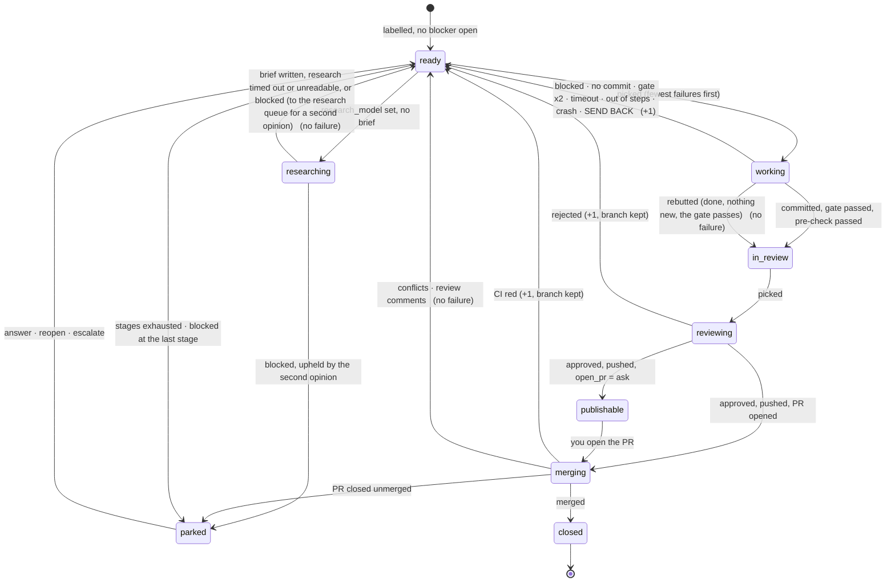

# The bead state machine: every state, every exit

What the loop does with a bead, state by state. The machine is one pure function,
`step(bead, event, policy) -> {bead, effects}` in `baml_src/ns_machine/step.baml`, and
every row of the outcome table below is a test in `step_test.baml` or
`ns_supervisor/supervisor_test.baml`.

> **A bead is always in exactly one place, and every place has an exit that is either
> automatic or a human's, and every wait has a timeout that re-reads the world.**

A state with no exit is a deadlock. A wait with no timeout is a deadlock waiting for a
lost signal. An infrastructure failure counted as a bead failure is a livelock: the queue
burns through its stages while nothing is wrong with the beads.

## One bead, start to finish

A **round** is worker → gate (one fix round on failure) → pre-check → reviewer → PR.
Three things end a round early and send the bead **back to ready**, with a note on the
bead saying what happened and **one more failure** on its count:

- the work round: the worker reports blocked, makes no commit, times out, crashes, or
  the gate fails twice. The branch is removed and the next round starts fresh. A change
  the round left uncommitted is saved first, as a patch beside the bead's log.
- the pre-check says SEND BACK, or the reviewer rejects. The branch is *kept*, and the
  next worker fixes its commit in place.
- the merge queue: CI red. Same branch, kept; the next round's push updates the PR.

Three send-backs are not failures. A PR that **conflicts with the base** goes back on its
branch with a rebase order, and that round's worker is `conflict_worker` (the last
stage's by default): resolving a conflict is judgement. **Review comments** from someone
other than the loop's account do the same, with the comments as the order. And
**infrastructure is never the bead's failure**: setup failing, git refusing the worktree,
a session that returns nothing from the model, `gh` or the push refusing, a usage limit.
The round did not happen. The bead stays where it is, **held** with the reason, and is
tried again a few ticks later (a usage limit: a minute past the reset it states, or half
an hour when it states none, and every round on that provider waits with it). A harness that fails five times in a row, with nothing else
between, parks the bead with its words: it is broken, and retrying all night fixes nothing.

The failure count chooses the **stage** ([config.md](config.md#stages)). Ready beads go
fewest failures first, so everything is tried once before anything is tried twice. The
next worker's prompt carries the last send-back's note (`last_note`): the reviewer's
work order, the gate's output, the pre-check's block, CI's failing checks.

Three things **park** a bead for you: the stages run out (`on_exhaust = "park"`), the
last stage's worker reports blocked, or its PR is closed unmerged. A researcher's
blocked, upheld by a second opinion, parks it before any edit. A parked bead takes an
answer, a reopen or an escalation from the page or `bead-supervisor tell`.

## What the state is made of

The loop's state is its event log. A bead's place is a fold of its events:

| where | what |
| --- | --- |
| `STATE/beads/ID/events.jsonl` | every event, in order, each with `at` (the second it was written). The source of truth: a restart folds it again |
| `STATE/beads/ID/{brief,report,park.md,watch.json,uncommitted.patch}` | the researcher's brief (every worker prompt carries it), the worker's last report (for the reviewer), a parking's question, the PR watcher's clocks, and what the last removed worktree held uncommitted |
| `STATE/rounds/ID.{spec.json,pid,result.json,timedout}` | a round in flight: what it was given, its process, what it found, and whether its time ran out |
| `STATE/wt/ID`, branch `bead/ID` | the work |
| `STATE/inbox/` | your answers, reopens and escalations, taken on the next tick |
| bd | the bead's text, its label, blockers, and its status, which the loop keeps: `in_progress` once it picks the bead, `blocked` when it parks, `open` when you answer, reopen or escalate, closed on merge. Its place is a label too, one at a time: `loop:ready`, `loop:research`, `loop:work`, `loop:review-queue`, `loop:review`, `loop:ready-for-pr`, `loop:merging`, `loop:parked`; `bd list -l loop:ready-for-pr` is what waits for your Open PR. Only a bead `bd ready` lists, or one the loop carries (`in_progress`), is picked or reviewed. The loop notes each event on the bead |
| GitHub | the PR: open (checks pending, green, red, none; conflicting; behind), merged, closed |

`STATE` is `~/.local/state/bead-loop/<repo>/baml/`; a target's is under it, in
`targets/NAME/`.

## The states

| place | who exits it |
| --- | --- |
| **ready** | the supervisor, when the stage's model server has a free slot and the dev lane is not paused by `max_inflight` or `max_open_prs` |
| **researching** | the research round: a brief, a block, or its time running out |
| **working** | the work round, then the gate and the pre-check |
| **in review** | the supervisor, when the reviewer's server has a slot |
| **reviewing** | the review round |
| **publishable** | you, opening the PR from the compare link; the loop picks it up |
| **merging** | the PR watcher, every tick |
| **parked** | you: answer, reopen, escalate |
| **closed** | terminal |

A **hold** is orthogonal to the place: the bead stays where it is, nothing is charged,
and the hold clears by trying again, after five ticks every time: there is no backoff, by
choice (11 Nov), and outside the merge queue each hold is noted. In the merge queue a hold is noted on the bead once
for each kind while its PR waits there; a later look of the same kind changes only the
words the page shows. A bead whose round's process is gone with no result is **lost**:
back to where it was picked from, uncharged.

## Invariants

1. **One place.** A bead's place is one value of a union; it cannot be in two queues.
2. **Every wait times out and re-reads the world.** Each tick (30 s) reads bd, the rounds
   and every open PR. A round runs under `worker_timeout` or `research_timeout`. A PR
   that is green but unmerged under `pipeline`, or has no checks, is held after its
   clock runs out.
3. **Infrastructure is never a bead failure.** Only a model outcome can be charged: the
   `charge` function takes the `ModelOutcome` union, so passing it an infrastructure
   event does not compile.
4. **A round is its own process.** A round is a detached process; a stop or a restart
   of the loop (`KillMode=process`) leaves it running, and the next tick takes its result.
5. **Start is a recovery.** Every start folds every log, takes the results of rounds
   that ended while the loop was down, and marks a bead whose round has no process and no
   result as lost.

## What each outcome does to the bead

| Outcome | Bead | Branch / PR |
| --- | --- | --- |
| Researcher writes a brief | ready with the brief, **no failure** | the worktree stays for the worker |
| Research runs out of time, answers nothing that parses, or answers with nothing read | ready with an empty brief: the worker goes without one | stays |
| Researcher blocked | noted, and back to the research queue for a **second opinion** (`brief_model`, else the researcher again) with the first reply in its prompt; it starts like any research round, on a free lane | stays |
| … the second opinion writes a brief | ready, **no failure** | stays |
| … the second opinion is blocked too | parked before any edit | removed |
| No brief yet, and the worker's server has a slot | worked without one: the GPU never waits on the CPU | as any work round |
| Worker blocked | +1 failure; ready, or parked at the last stage | removed; what the round left uncommitted is saved first as `STATE/beads/ID/uncommitted.patch`, and a note on the bead says so |
| No commit, timed out, ran out of steps, worker crashed | +1 failure; ready | removed |
| Done with no new commit, on a branch that already holds work, and the gate still passes | **rebutted**: back to review, **no failure**, the report as the rebuttal, reviewed by the last stage's reviewer | kept |
| Worker reports done with its change uncommitted | the round commits it, and the gate decides | — |
| Setup fails, git refuses the worktree, a session returns nothing | **held**, no failure | removed unless a round had committed |
| A Claude usage limit | **held**, no failure; no claude round starts until it clears | as it was |
| The harness held five times in a row (the same broken CLI) | **parked** with its words, no failure | as it was |
| Gate fails twice (one fix round with its output) | +1 failure; ready | removed |
| Gate passes, pre-check passes (or cannot answer) | in review | kept |
| Gate passes on a stage with no reviewer | approved: straight to the PR (or the push, under `open_pr = "ask"`), noted | kept |
| Pre-check SEND BACK | +1 failure; ready, the block as the note | kept |
| Reviewer rejects | +1 failure; ready, the work order as the note. The reviewer reads the gate's command and output, and a claim that something breaks must quote the output that shows it | kept |
| The same rejection twice running | +1, and the count jumps to the next stage with another worker; parked if there is none | kept |
| Reviewer returns no verdict | **held** in review, no failure | kept |
| Reviewer approves | merging | pushed; PR opened (`ID: title`), or the open one updated |
| Reviewer approves under `open_pr = "ask"` | publishable, the compare link on the page | pushed; no PR until you open it |
| Push or `gh pr create` refused | **held** in review | as it was |
| CI green, `merge = "auto"` | closed with the PR url | squash-merged, branch deleted |
| CI green, `merge = "pipeline"` | waits for the pipeline to merge; held after 30 min | labelled `merge_label` |
| CI green, `merge = "manual"` | **held**: yours to merge | PR left open |
| CI green, `merge = "external"` | waits for the maintainer, no hold | PR left open |
| CI red | +1 failure; ready | kept; the next push updates the PR |
| CI red again on the commit already charged | under `pipeline`, relabelled once to run CI again, and the re-run's own red is charged; otherwise held | unchanged |
| CI red, every failing required check killed, `pipeline` | no failure; CI re-run once on the same head | unchanged |
| CI red only in checks the base does not require | no failure; waits | unchanged |
| CI red on a PR from someone else (adopted) | **held** | left for whoever opened it |
| No checks reported five minutes on | **held** | waits |
| PR behind the base, `update_behind` | the branch is updated | updated |
| PR conflicts with the base | **no failure**; ready with the rebase order, for `conflict_worker` | kept; the push updates the PR |
| Review comments from someone else on the loop's PR | **no failure**; ready with the comments as the note, for `conflict_worker` | kept |
| An adopted PR conflicts | left alone | whoever opened it rebases |
| A dev-queue bead's PR merged outside the loop, before the loop picked it | closed, the bead closed in bd with the url | deleted |
| An open `bead/ID` PR the loop is not carrying | merging; the loop's own if its account opened it (a PR left by the Rust loop), else adopted | labelled under `pipeline` |
| A parked bead's `bead/ID` PR, opened or merged by hand | open: merging, as above; merged: closed, the bead closed in bd with the url | deleted |
| PR merged | closed, the bead closed in bd with the url | deleted, with the worktree and the local branch |
| PR closed unmerged | parked, the url in the question | gone |
| PR closed while a rebase or feedback round ran | parked once the round is approved, the url in the question; no new PR | gone |
| Stages exhausted (`on_exhaust = "park"`) | parked | removed |
| The last stage says BLOCKED after an earlier round's work passed the gate | parked | kept, for a publish |
| A round's process gone with no result | lost: back where it was picked from, **no failure** | as it was |

## Transitions you make

| from | you | to | count |
| --- | --- | --- | --- |
| parked | answer TEXT | ready, the text as the next round's note | −1 |
| parked | reopen | ready, count as is | — |
| parked by research (both opinions BLOCKED) | answer, reopen or escalate | as above, but to the worker without a brief: research would not read your answer and could block again | as above |
| parked | escalate | ready at the last stage | set |
| parked, its branch holding work | publish (Ready for PR) | the branch pushed, publishable: a compare link and Open PR for you | — |
| publishable | open_pr TITLE BODY (Open PR) | the PR opened with your title and body, then the merge queue | — |
| anything else | answer, reopen or escalate | refused, with a note saying why | — |
| ready | label it `stage:NAME` in bd | ready at that stage's first attempt, as escalate does; never back to an earlier one | set |
| a bead in bd | close it, block it, defer it, or take its label off | not picked or reviewed again: only what `bd ready` lists, and the loop's own `in_progress`, are. A round already running finishes | — |
| a labelled bead the loop has never picked | set it in_progress | never picked: the loop carries only the in_progress beads it set itself, by its log or their loop: label; set it open to give it to the loop | — |

## Not built

- A server that is down is found one round at a time (each is held) rather than once by
  a probe.
- `diff_checks`, and `research = "every"`.
- Disk is not watched.
